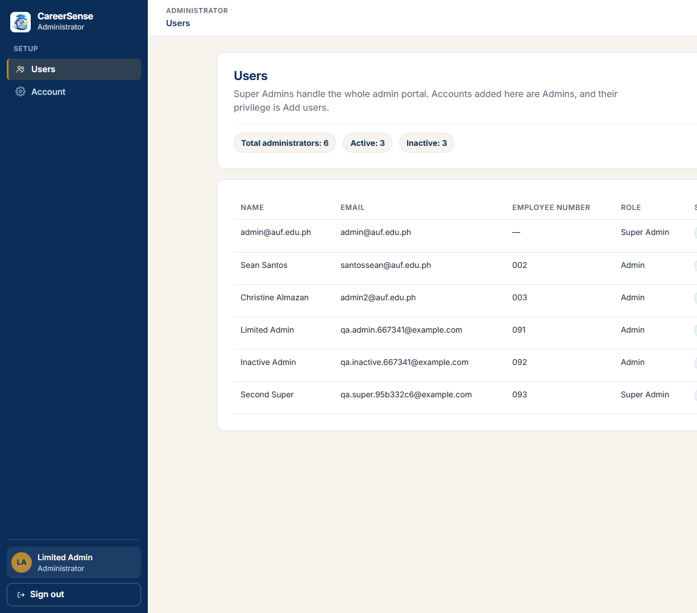
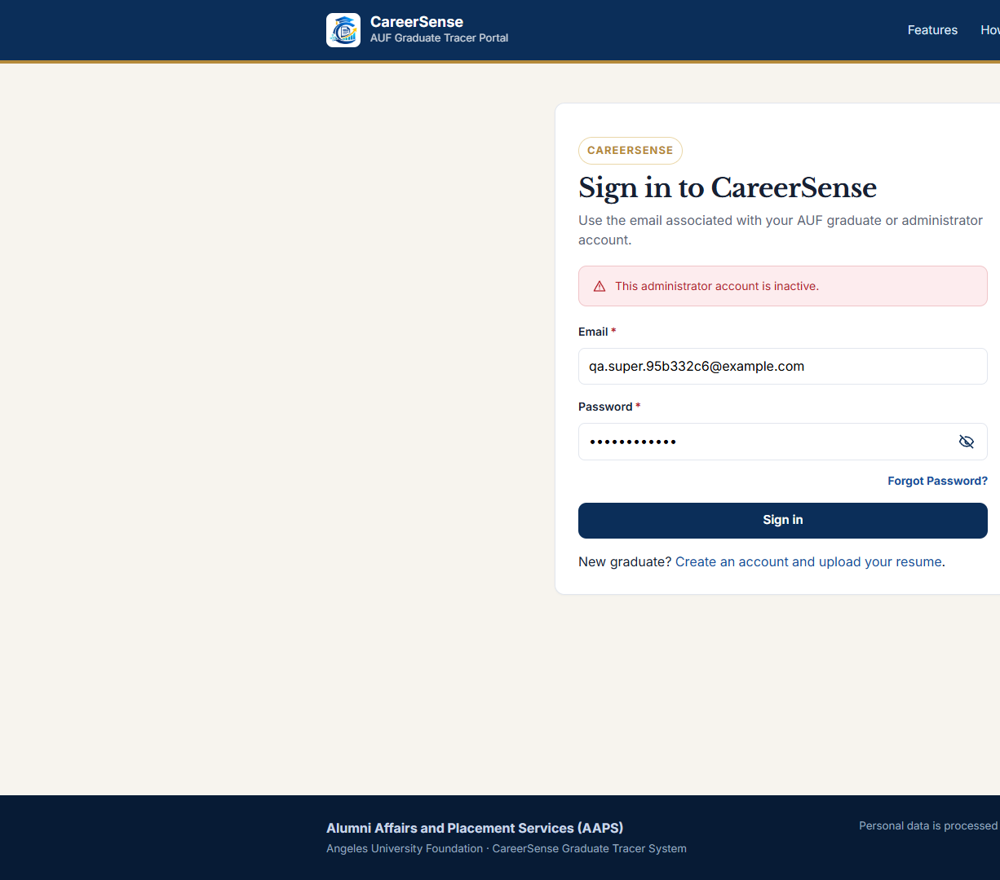
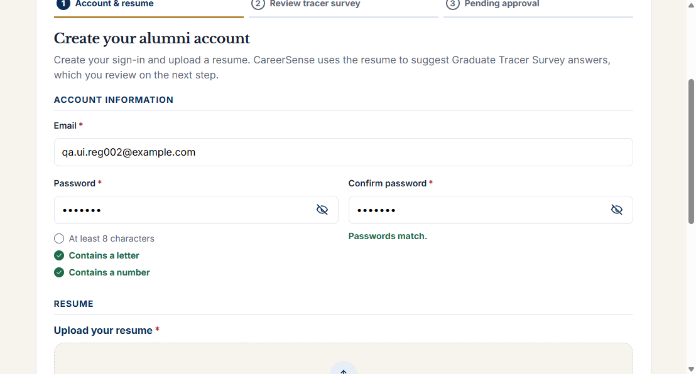
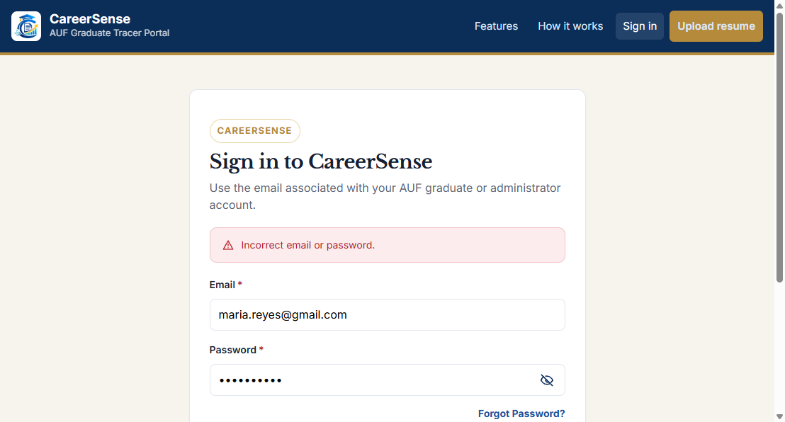
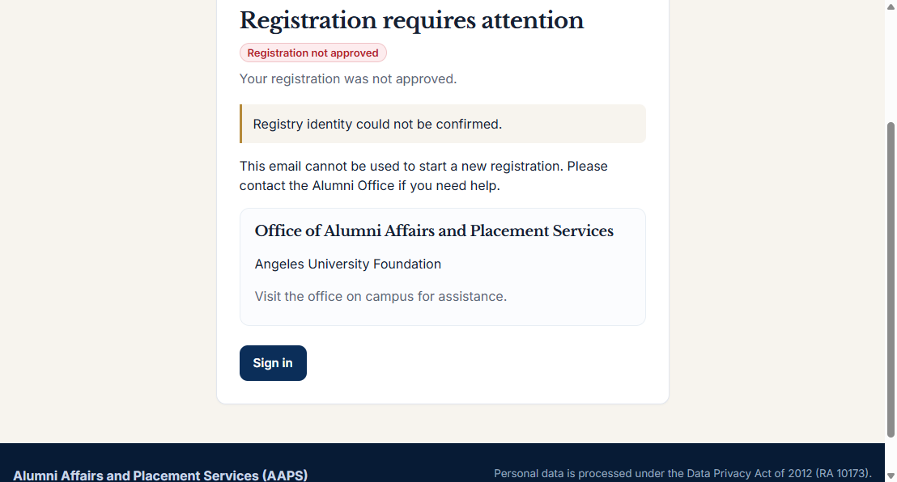
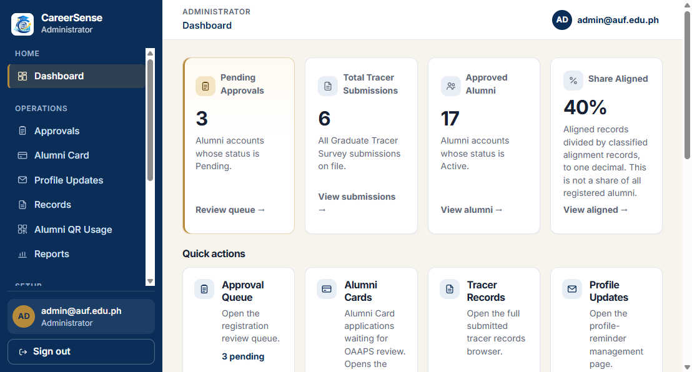
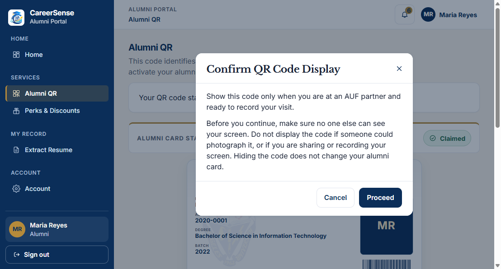

# ITE40 — Software Quality Assurance

# Software Testing Package

**System under test:** CareerSense  
**Course:** ITE40 — Software Quality Assurance  
**Document status:** Executed on 9 November 2026 against the local working copy. A follow-up the same day closed the blocked Super Admin case and ran the draft-expiry and PIN cases the first session could not finish. Twenty-three cases passed. None are blocked. No confirmed defect.

This package follows the organization of the ITE40 final-project template. The system under test is CareerSense, the web-based Graduate Tracer System developed for the Angeles University Foundation Office of Alumni Affairs and Placement Services (OAAPS). Sample content from the template is not used.

The core principle of this course is retained: the package evaluates how the group performs software quality assurance. It does not try to prove that CareerSense has no defects, and it does not treat a large test count as evidence of quality.

---

## Information status

Three kinds of statements appear in this package.

| Kind | Meaning in this document |
| --- | --- |
| Confirmed | Observed in the current CareerSense source code, configuration defaults, or project documents that describe the implemented system. |
| QA recommendation | A testing decision made for this package, such as which rule to test and which data value represents a partition. |
| Requires verification | Not established by the materials reviewed. The document does not invent a result for it. |

**Confirmed sources used**

- Implemented application behavior in `backend/app`, including registration, authentication, password reset, resume file checks, survey completion, approval, alignment, and Alumni QR.
- Project documents `docs/UAT-testing-guide.md`, `docs/alumni-qr-and-card.md`, and `README.md`, where they agree with the current code.
- The approved system description already aligned with the running system: three roles (Super Admin, Admin, Alumni), registration draft, fixed Graduate Tracer Survey (GTS), built-in resume parser with optional LlamaParse, and alignment values Aligned, Misaligned, and Unknown.

**Not used as execution evidence for this package**

- `docs/QA-inspection-report.md` (13 September 2026) records an earlier inspection. That report’s defects, pass counts, and remediation notes belong to that build. They are not results of the test cases in this package.
- The manuscript statement that a backend automated suite recorded 269 passed tests is a separate automated run. Those tests are not mapped one-to-one to the cases below, and this package does not repeat that count as a manual execution result.

**Execution record**

The first 20 cases were executed on 9 November 2026 against the local CareerSense process: Vite at `http://127.0.0.1:5173` and FastAPI at `http://127.0.0.1:8000`, SQLite file `backend/careersense.db`. The health response reported `environment=development`, `llm_configured=false`, and `email_enabled=false`. Repository HEAD was `4db53a7`, and the working tree already contained uncommitted changes, so this is the local working copy rather than a tagged release. During that first session `SECRET_KEY` was not set, so the process generated an ephemeral development key.

A follow-up on the same date used the same working copy and the same local database. The API process for that follow-up was given a development `SECRET_KEY` so a PIN hash created by that process could be matched. The key was not written into this package, and it was removed when the follow-up ended. Email remained disabled. LlamaParse remained unconfigured. The follow-up evidence is `docs/qa-evidence/execution-results-followup.json`, `EV-AUTH-002-limited-nav.png`, and `EV-AUTH-003-inactive.png`.

**Still required from the group before the defense**

- Group number and member names.
- A personal account of the team’s own execution experience, if the group wants Section 13 to name who did the work.
- A second member’s comparison of Section 8 with the files in `docs/qa-evidence/`.
- A decision on the local QA accounts created during this run. They remain in the local database.

---

## 1. Purpose and Scope

The CareerSense group acts as the quality-assurance team for its own capstone system. The team’s responsibility is to analyze the implemented behavior, turn that behavior into testable conditions, design a focused set of tests, and record only what is actually observed when those tests are run.

This package covers the work the course evaluates:

- analysis of the test basis and identification of testable conditions
- design of scenarios and executable test cases
- deliberate test data, using equivalence partitioning, boundary value analysis, decision tables, and state transition testing only where a rule supports the technique
- a practical test plan
- an execution record that separates Pass, Fail, Blocked, and Not Executed
- defect investigation after a failed observation, not before
- retesting and regression only after a confirmed defect is fixed
- metrics and a summary that stay inside the evidence
- a defense of the testing decisions

| This package is evaluated on | This package is not evaluated on |
| --- | --- |
| Correctness of the test design | How many defects CareerSense contains |
| Meaningful coverage of implemented rules | How many test cases were written |
| Quality of cases, data, and expected results | Document length |
| Execution discipline and evidence | How complex the capstone looks |
| Quality of defect reporting, when a defect is confirmed | Whether the system is perfect |
| Justification of techniques and conclusions | Finding the largest number of bugs |
| Professional, traceable documentation | The number of screenshots alone |

The testing scope is the graduate-tracer path and the access rules that protect it: registration and resume checks, survey submission, account status, Super Admin approval, the restricted Admin role, stored course-career alignment, password-reset PIN handling, and the rule that displaying an Alumni QR code does not record a partner scan.

Alumni Card processing, partner perks, badges, reports, and the full parser accuracy of every resume layout are outside this execution set. The reason is coverage control, not a claim that those areas are unimportant. They are named in Section 2 and in the test plan.

---

## 2. QA Project Overview

| Item | Content |
| --- | --- |
| Course | ITE40 — Software Quality Assurance |
| Project | Software Testing Package for CareerSense |
| Testing team | CareerSense capstone group. Member names and the group number are not recorded in the repository. Section 13 leaves those fields for the group. |
| System under test | CareerSense |
| Version / build | No release tag. Both sessions used the local working copy at commit `4db53a7` with the uncommitted changes already in the tree. This is not a hosted Render build. |
| Testing period | 9 November 2026. The first session ran the original 20 cases. The follow-up the same day ran TC-AUTH-003, the Admin screen, the draft expiry, and the PIN expiry and reset. |

### System description

CareerSense is a web application for graduate tracing at Angeles University Foundation. An applicant registers with an email address, a password, privacy consent, and one resume. The system stores a registration draft. It does not create an alumni account until the applicant submits the Graduate Tracer Survey. Submission creates the account with Pending status. A Super Admin approves the account, which sets it to Active, or rejects it with a reason, which sets it to Rejected.

The built-in parser extracts resume fields. LlamaParse may read the file first when it is configured. Tesseract reads scanned content inside an accepted PDF, DOCX, or TXT file. The applicant reviews and corrects the extracted information before submission. A match to the official graduate registry uses the email address first and then the name. A middle name is compared only when the resume contains one. A match supplies the student number, academic program, and graduation year. The applicant does not type a student number. An unmatched registration can still be submitted for Super Admin review.

The survey is fixed. It collects general information, employment, further education and professional development, and institutional feedback. The Super Admin reviews submitted responses and can correct the stored tracer record. The Admin role can add administrator accounts and manage that account’s own settings. It cannot open the other administrative modules.

After approval, an Active alumnus can maintain permitted profile information, display an Alumni QR code, and use the other alumni-portal functions. Displaying the QR code does not record a partner scan.

### Main features included in the testing scope

- Registration draft, password rule, resume file rule, and registry match
- Fixed GTS completion and creation of a Pending account
- Super Admin approval and rejection
- Sign-in destination by role and account status
- Restriction of the Admin role
- Stored course-career alignment when work history is edited
- Password-reset PIN attempts, PIN expiry, and a completed reset
- Alumni QR display versus a recorded QR scan
- Registration draft expiry

### Features excluded from testing and justification

| Excluded area | Justification |
| --- | --- |
| Official institutional adoption by OAAPS | CareerSense is a research prototype. Adoption is an organizational decision, not a software behavior. |
| Measured parser accuracy across a resume corpus | No validated accuracy dataset is part of this test basis. Perception scores in the manuscript are not an expected result for a functional test. |
| LlamaParse, and Resend delivery when email is disabled | The built-in parser and the PIN rules that do not need an inbox were tested. Inbox delivery was not observed. It is not marked as a failed product test while email is disabled. |
| Full payroll of alumni services (card workflow, perk catalogue, badges, report exports) | These functions exist. They are excluded from this execution set so the package stays on the registration, access, and tracer rules. A later cycle can add them. |
| Production Render billing and the LlamaCloud free-plan limit | Cost is an operating fact, not a functional requirement of the cases below. |
| Automated pytest as a substitute for these cases | The backend suite is useful developer evidence. It does not execute the steps written in Section 5. |

### Test environment

| Component | Confirmed arrangement |
| --- | --- |
| Frontend | React with Vite. Local development server: `http://localhost:5173` |
| Backend | FastAPI. Local API: `http://127.0.0.1:8000` |
| Database | SQLite by default in local development. PostgreSQL is the production database. This package is designed for the local stack unless the group records a hosted build. |
| Browsers named by the project | Google Chrome and Microsoft Edge |
| Resume limit used in the cases | `max_upload_mb` default of 10. The size check rejects a file only when its length is greater than 10 × 1024 × 1024 bytes. |
| Email | Resend, when email is enabled. Local execution may have email disabled. |

### Test basis

- Implemented behavior cited above
- `docs/UAT-testing-guide.md` for local startup and seeded accounts, where that guide still matches the code
- The system description used in the capstone methodology for roles, registration, the fixed survey, alignment, and QR display

Where the manuscript and the code could be read differently, the testable condition follows the code, and the difference is listed in Section 3.

### Primary users and roles

| Actor | Confirmed access |
| --- | --- |
| Applicant (Visitor before an account exists) | Starts registration, uploads one resume, reviews extracted data, and submits the GTS. |
| Alumni, Pending | Can sign in. Sees the pending status page. Cannot open the alumni portal. |
| Alumni, Active | Opens the alumni portal. |
| Alumni, Rejected | Can sign in. Sees the rejection reason. Cannot open the alumni portal. |
| Super Admin, Active | Opens the full administrative portal, including approvals and Alumni QR Usage. |
| Admin, Active | Opens Users and that account’s own Account page. Can add an Admin. Cannot open the other administrative modules. |
| Super Admin or Admin, Inactive | Cannot use the portal. |

There is no separate student role. Graduating students who are not yet using an alumni registration are not actors in these cases.

---

## 3. Requirements / Test Basis Analysis

The identifiers below are QA identifiers for this package. They are not identifiers from a formal requirements database. Each row states only a behavior that the current implementation supports.

| Requirement ID | Requirement description | QA interpretation / testable condition |
| --- | --- | --- |
| REQ-REG-01 | Registration collects an email address, a password, privacy consent, and one resume. The system stores a draft and does not create an alumni account at this step. | After a valid start, the applicant can continue to review. No alumni account exists yet for that email. |
| REQ-REG-02 | A password must be at least 8 characters and must contain at least one letter and one number. | A shorter password, or an 8-character password with no digit, is rejected with the password hint. A password that meets both parts is accepted by this rule. |
| REQ-REG-03 | The resume must be a non-empty PDF, DOCX, or TXT file no larger than the configured maximum. The default maximum is 10 MB, implemented as 10 × 1024 × 1024 bytes. A file is over the limit only when its length is greater than that value. | An empty file, a `.jpg`, and a file of 10 × 1024 × 1024 + 1 bytes are rejected. A TXT file of exactly 10 × 1024 × 1024 bytes is not rejected for size. |
| REQ-REG-04 | A registration draft expires 24 hours after it is created. | A draft that is still inside 24 hours can be continued. A draft past that time cannot be completed as the same draft. This case needs a way to move the clock or to wait. |
| REQ-REG-05 | Registry matching runs when the resume is uploaded. The email address is tried first, then the name. The middle name is compared only when the resume has one. A match supplies the student number, academic program, and graduation year. The applicant does not enter a student number. An unmatched registration can still be submitted. | On a match, those three registry values are shown and the form does not ask for a student number. On no match, the applicant can still reach survey submission. |
| REQ-REG-06 | Submitting the completed survey stores the tracer record and creates the alumni account with Pending status. | Immediately after submit, signing in opens the pending status page and does not open `/alumni`. |
| REQ-GTS-01 | The survey is fixed. Required answers must be present before submission. Personnel do not add questions or publish another survey version. | A blank required answer blocks submission. The administrative navigation available to the Super Admin does not include a survey editor. |
| REQ-GTS-02 | The applicant reviews and can correct extracted fields before submission. When a registry match exists, the registry academic program and graduation year are kept instead of the resume values for those fields. | Corrected answers are what the Pending record shows. Matched program and year follow the registry. |
| REQ-APR-01 | The Super Admin approves or rejects a Pending account. Approval sets Active and opens the alumni portal. Rejection requires a reason, sets Rejected, and shows that reason on the status page. | Both outcomes are visible after the next sign-in by that alumnus. |
| REQ-APR-02 | The last Active Super Admin cannot be deactivated. | The control that would deactivate that account is refused, and the account can still sign in. |
| REQ-AUTH-01 | After sign-in, the destination depends on role and status, as listed in Section 2. | Each selected combination opens only its allowed area. |
| REQ-AUTH-02 | An incorrect email and password pair is rejected. CareerSense does not implement a “lock after three incorrect passwords” rule. | The sign-in stays on the sign-in error. The same account can still sign in with the correct password afterward. |
| REQ-ALN-01 | Alignment is stored as Aligned, Misaligned, or Unknown. It is calculated when the tracer record is saved and when a Super Admin corrects that record. Editing work history alone does not recalculate the stored alignment. | After a work-history edit, the alignment value shown on the tracer record is the same value as before the edit. |
| REQ-PWD-01 | Password reset sends a 6-digit PIN that expires in 10 minutes. The fifth incorrect PIN locks that PIN. The holder must request a new one. The message after one to four wrong PINs is “The PIN is incorrect. Please try again.” The lock message is “Too many incorrect attempts. Please request a new PIN.” | The fourth wrong PIN does not lock. The fifth wrong PIN locks. This case requires a delivered or otherwise readable PIN so that the tester is entering a wrong code against a real request. |
| REQ-QR-01 | An Active alumnus can display an Alumni QR code after confirming the prompt. Displaying the code does not create an Alumni QR Usage record. A Super Admin records a scan only by submitting the signed value or the verification link. | The usage list count for that alumnus is unchanged after display alone. |

### Ambiguities and gaps

These items are not given an invented expected result.

1. **Draft expiry (REQ-REG-04).** The follow-up did not wait 24 hours. It set the draft’s `expires_at` to 1 January 2000 in the local database and then submitted the survey token. The API returned “Your resume review session expired. Please upload your resume again.” The draft row was deleted and no account was created. A real 24-hour wait was not performed.

2. **On-screen wording for registry mismatch.** The match rule is confirmed. The exact sentence shown when no record matches was not copied into an expected result. The test checks the observable outcome: the applicant can continue, and no student number was typed by the applicant.

3. **Email delivery (REQ-PWD-01).** Email remained disabled. The server log recorded “Transactional email skipped” and the audit action `password_reset_email_failed`. No inbox was opened. The PIN counter, the expiry message, and a completed reset were still observed. The issued PIN was matched from the local hash with the same development secret the follow-up process was using. The PIN is not written in this package. That match is not evidence that an email arrived.

4. **Which registry rows are still unused.** All 20 seeded university records were already linked to accounts. TC-REG-008 therefore used a new registry row created through the Super Admin university-record function, `QA-6101f4`.

5. **Hosted build versus local build.** Both sessions used the local working copy. A hosted Render configuration was not tested. Results from this database are not copied onto a hosted build.

6. **Team identity.** The group number and member names are not in the repository. They are not invented in Section 13.

7. **Second Super Admin.** The Users function always creates an Admin with the add-users privilege. It does not create a Super Admin. For TC-AUTH-003 the follow-up created `qa.super.95b332c6@example.com` through Users, then cleared `admin_privileges` in the local database so the account met the system’s own full-access rule. The seeded Super Admin then deactivated that account through the API. The privilege change was test data, not a screen the product offers.

### 3.1 Requirements traceability

| Requirement | Cases | Execution |
| --- | --- | --- |
| REQ-REG-01 | TC-REG-001 | Pass |
| REQ-REG-02 | TC-REG-002, TC-REG-003 | Pass |
| REQ-REG-03 | TC-REG-004, TC-REG-005, TC-REG-006, TC-REG-007 | Pass |
| REQ-REG-04 | TC-REG-010 | Pass, with the clock moved in the local database |
| REQ-REG-05 | TC-REG-008, TC-REG-009 | Pass |
| REQ-REG-06 | TC-GTS-002 | Pass |
| REQ-GTS-01 | TC-GTS-001 | Pass |
| REQ-GTS-02 | TC-GTS-002 | Pass |
| REQ-APR-01 | TC-APR-001, TC-APR-002 | Pass |
| REQ-APR-02 | TC-APR-003 | Pass. The last active Super Admin was not deactivated. The separate last-administrator sentence was not returned. |
| REQ-AUTH-01 | TC-GTS-002, TC-APR-001, TC-APR-002, TC-AUTH-002, TC-AUTH-003 | Pass |
| REQ-AUTH-02 | TC-AUTH-001 | Pass |
| REQ-ALN-01 | TC-ALN-001 | Pass |
| REQ-PWD-01 | TC-PWD-001, TC-PWD-002, TC-PWD-003 | Pass for the counter, the expiry message, and a completed reset. Inbox delivery was not observed. |
| REQ-QR-01 | TC-QR-001 | Pass |

---

## 4. Test Scenarios

A scenario names the situation to be tested. The steps and data are in Section 5.

| Scenario ID | Requirement ID | Test scenario description |
| --- | --- | --- |
| TS-REG-01 | REQ-REG-01 | Start registration with a valid email, a valid password, consent, and one accepted resume, and confirm that no alumni account exists yet. |
| TS-REG-02 | REQ-REG-02 | Reject a password that misses the length rule, and reject a password that meets the length but misses the letter-and-number rule. |
| TS-REG-03 | REQ-REG-03 | Reject an empty resume and a resume whose type is not PDF, DOCX, or TXT. |
| TS-REG-04 | REQ-REG-03 | Check the file-size rule at the configured maximum and one byte above it. |
| TS-REG-05 | REQ-REG-05 | Show registry identity on an email match, and still allow submission when there is no match. |
| TS-REG-06 | REQ-REG-04 | Complete a registration draft only while it is inside its 24-hour lifetime. |
| TS-GTS-01 | REQ-GTS-01 | Block survey submission while a required answer is blank, and confirm that the survey is not an editable admin instrument. |
| TS-GTS-02 | REQ-REG-06, REQ-GTS-02 | Submit a completed survey and confirm the Pending account and the saved answers. |
| TS-APR-01 | REQ-APR-01 | Approve a Pending account and open the alumni portal. |
| TS-APR-02 | REQ-APR-01 | Reject a Pending account only when a reason is supplied, and show that reason to the alumnus. |
| TS-APR-03 | REQ-APR-02 | Attempt to deactivate the last Active Super Admin. |
| TS-AUTH-01 | REQ-AUTH-02 | Sign in with a wrong password and then with the correct password. |
| TS-AUTH-02 | REQ-AUTH-01 | Sign in as an Active Admin and as an Active Super Admin and compare the navigation. |
| TS-AUTH-03 | REQ-AUTH-01 | Sign in with an Inactive Super Admin account. |
| TS-ALN-01 | REQ-ALN-01 | Edit work history and compare the stored alignment before and after. |
| TS-PWD-01 | REQ-PWD-01 | Enter wrong reset PINs through the fourth and fifth attempts. |
| TS-PWD-02 | REQ-PWD-01 | Submit a PIN after that challenge’s expiry time. |
| TS-PWD-03 | REQ-PWD-01 | Submit the issued PIN, set a new password, and sign in with it. |
| TS-QR-01 | REQ-QR-01 | Display an Alumni QR code and confirm that Alumni QR Usage does not gain a row from that display. |

TS-REG-04 uses boundary values. TS-AUTH-02 is one slice of the sign-in decision table in Section 6. TS-PWD-01, TS-PWD-02, TS-PWD-03, and TS-GTS-02 / TS-APR-01 / TS-APR-02 are state sequences. TS-REG-06 is the draft lifetime. The other scenarios are equivalence or rule checks. The three scenarios added in the follow-up are the ones the first session could not run. No scenario was added only to raise the count.

---

## 5. Test Cases

Priority is High when a failure would admit the wrong person, store the wrong official record, or block the registration path. Priority is Medium when the failure is a control that does not by itself corrupt the tracer record.

Shared local precondition, unless a case says otherwise: the API is running at `http://127.0.0.1:8000`, the frontend is running at `http://localhost:5173`, and the tester is using Chrome or Edge. Seeded passwords below come from `docs/UAT-testing-guide.md`. They are for a local development database only.

### TC-REG-001

| Field | Content |
| --- | --- |
| Test Case ID | TC-REG-001 |
| Requirement ID | REQ-REG-01 |
| Scenario ID | TS-REG-01 |
| Title | Valid registration start stores a draft and does not create an account |
| Priority | High |
| Preconditions | The email `qa.reg001@example.com` is not already an account and is not an open draft. A small TXT resume file, `qa-reg001.txt`, contains a name and one job title. |
| Test Data | Email `qa.reg001@example.com`; password `Alumni@2026`; privacy consent checked; file `qa-reg001.txt`. |
| Steps | 1. Open `/register`. 2. Enter the email and password, confirm the password, upload `qa-reg001.txt`, and accept the privacy notice. 3. Submit the registration start. 4. Sign out if a session exists. 5. Open `/login` and attempt to sign in with the same email and password. |
| Expected Result | The registration start is accepted and the applicant is taken toward resume review or the survey, not into the alumni portal. Sign-in with that email does not open an alumni or admin portal, because no account exists until the survey is submitted. |

### TC-REG-002

| Field | Content |
| --- | --- |
| Test Case ID | TC-REG-002 |
| Requirement ID | REQ-REG-02 |
| Scenario ID | TS-REG-02 |
| Title | Reject a password of 7 characters |
| Priority | High |
| Preconditions | Registration start page is open. Any small TXT resume is available. |
| Test Data | Password `Abcdef1` (7 characters, with a letter and a number). Email `qa.reg002@example.com`. |
| Steps | 1. Enter the email, the password, and the password confirmation. 2. Upload the TXT resume and check consent. 3. Submit the registration start. |
| Expected Result | The start is not saved. The page shows: “Password must be at least 8 characters and include letters and numbers.” |

### TC-REG-003

| Field | Content |
| --- | --- |
| Test Case ID | TC-REG-003 |
| Requirement ID | REQ-REG-02 |
| Scenario ID | TS-REG-02 |
| Title | Reject an 8-character password that has no number |
| Priority | High |
| Preconditions | Registration start page is open. |
| Test Data | Password `abcdefgh` (length 8, letters only). Email `qa.reg003@example.com`. |
| Steps | 1. Enter the email, the password, and the confirmation. 2. Upload a small TXT resume and check consent. 3. Submit the registration start. |
| Expected Result | The start is not saved. The same password hint as TC-REG-002 is shown. |

### TC-REG-004

| Field | Content |
| --- | --- |
| Test Case ID | TC-REG-004 |
| Requirement ID | REQ-REG-03 |
| Scenario ID | TS-REG-03 |
| Title | Reject an empty resume file |
| Priority | High |
| Preconditions | Registration start page is open. An empty file named `empty.txt` exists and has length 0. |
| Test Data | Email `qa.reg004@example.com`; password `Alumni@2026`; file `empty.txt`. |
| Steps | 1. Complete the email, password, and consent. 2. Upload `empty.txt`. 3. Submit the registration start. |
| Expected Result | The draft is not saved. The system reports that the uploaded file is empty. |

### TC-REG-005

| Field | Content |
| --- | --- |
| Test Case ID | TC-REG-005 |
| Requirement ID | REQ-REG-03 |
| Scenario ID | TS-REG-03 |
| Title | Reject a JPEG file as a registration resume |
| Priority | High |
| Preconditions | A small `.jpg` file is available. JPEG is not a registration resume type. Profile photos are a different upload. |
| Test Data | Email `qa.reg005@example.com`; password `Alumni@2026`; file `photo.jpg`. |
| Steps | 1. Complete the email, password, and consent. 2. Upload `photo.jpg`. 3. Submit the registration start. |
| Expected Result | The draft is not saved. The system rejects the file because it is not PDF, DOCX, or TXT. |

### TC-REG-006

| Field | Content |
| --- | --- |
| Test Case ID | TC-REG-006 |
| Requirement ID | REQ-REG-03 |
| Scenario ID | TS-REG-04 |
| Title | Accept a resume whose size equals the 10 MB limit |
| Priority | Medium |
| Preconditions | `max_upload_mb` is 10. The tester has a TXT file of exactly 10,485,760 bytes. |
| Test Data | Email `qa.reg006@example.com`; password `Alumni@2026`; file length 10,485,760 bytes. |
| Steps | 1. Complete the email, password, and consent. 2. Upload the file. 3. Submit the registration start. |
| Expected Result | The system does not reject the file for size. It does not show “Resume must be 10 MB or smaller.” The start is accepted as a draft, or it fails only for a reason other than size. If it fails for another reason, record that reason and do not mark the size rule as failed. |

### TC-REG-007

| Field | Content |
| --- | --- |
| Test Case ID | TC-REG-007 |
| Requirement ID | REQ-REG-03 |
| Scenario ID | TS-REG-04 |
| Title | Reject a resume one byte above the 10 MB limit |
| Priority | High |
| Preconditions | `max_upload_mb` is 10. The tester has a TXT file of 10,485,761 bytes. |
| Test Data | Email `qa.reg007@example.com`; password `Alumni@2026`; file length 10,485,761 bytes. |
| Steps | 1. Complete the email, password, and consent. 2. Upload the file. 3. Submit the registration start. |
| Expected Result | The draft is not saved. The system shows “Resume must be 10 MB or smaller.” |

### TC-REG-008

| Field | Content |
| --- | --- |
| Test Case ID | TC-REG-008 |
| Requirement ID | REQ-REG-05 |
| Scenario ID | TS-REG-05 |
| Title | A registry email match supplies academic identity without a student-number field |
| Priority | High |
| Preconditions | The local graduate registry contains `paolo.navarro@gmail.com` with student number `2022-0112`, and that email has no alumni account and no open draft. If that row is already used, choose another unused registry email and record it in the execution log. The resume text includes the same email and the graduate’s name as stored in the registry. |
| Test Data | Registry email and matching name; password `Alumni@2026`; one TXT resume. |
| Steps | 1. Start registration with that email and resume. 2. Open the review page. 3. Look for a field that asks the applicant to type a student number. 4. Read the student number, academic program, and graduation year shown from the match. |
| Expected Result | The review page shows the registry student number, academic program, and graduation year. There is no control that requires the applicant to enter a student number. |

### TC-REG-009

| Field | Content |
| --- | --- |
| Test Case ID | TC-REG-009 |
| Requirement ID | REQ-REG-05 |
| Scenario ID | TS-REG-05 |
| Title | An unmatched registration can still move on to the survey |
| Priority | High |
| Preconditions | `qa.unmatched@example.com` is not in the graduate registry and has no account. |
| Test Data | That email; password `Alumni@2026`; a TXT resume whose name will not match a registry row. |
| Steps | 1. Start registration. 2. Open the review page and note the match result. 3. Continue into the survey. |
| Expected Result | The review page does not present a registry match. The applicant is not stopped from opening the survey. |

### TC-REG-010

| Field | Content |
| --- | --- |
| Test Case ID | TC-REG-010 |
| Requirement ID | REQ-REG-04 |
| Scenario ID | TS-REG-06 |
| Title | An expired registration draft cannot be completed |
| Priority | High |
| Preconditions | A registration start has been accepted for an email that has no alumni account. The tester can set that draft’s `expires_at` into the past, or can wait 24 hours. Record which method was used. |
| Test Data | A new address, password `Alumni@2026`, and one small TXT resume. |
| Steps | 1. Start registration and keep the registration token. 2. Move the draft expiry into the past, or wait until it has passed. 3. Submit the survey with that token. 4. Attempt to sign in with the same email and password. |
| Expected Result | The survey submission does not create an account. The response says “Your resume review session expired. Please upload your resume again.” Sign-in does not open a portal. |

### TC-GTS-001

| Field | Content |
| --- | --- |
| Test Case ID | TC-GTS-001 |
| Requirement ID | REQ-GTS-01 |
| Scenario ID | TS-GTS-01 |
| Title | A blank required survey answer blocks submission |
| Priority | High |
| Preconditions | TC-REG-009, or another fresh draft, is on the survey page. The tester has identified one answer marked required. |
| Test Data | All other required answers filled with sample values. One required answer left blank. |
| Steps | 1. Leave the chosen required answer empty. 2. Attempt to submit the survey. 3. Sign in as the Super Admin `admin@auf.edu.ph` / `Admin@AUF2026` on a separate session. 4. Inspect the admin navigation for a page that edits or publishes the survey. |
| Expected Result | Submission does not create an account. The applicant remains on the survey with an indication that the required answer is missing. The Super Admin navigation has no survey-editor page. Direct opening of `/admin/survey` does not open an editor. |

### TC-GTS-002

| Field | Content |
| --- | --- |
| Test Case ID | TC-GTS-002 |
| Requirement ID | REQ-REG-06, REQ-GTS-02 |
| Scenario ID | TS-GTS-02 |
| Title | Survey submission creates a Pending account and keeps the corrected answer |
| Priority | High |
| Preconditions | A fresh unmatched draft exists. The tester changes one extracted job title to `QA Analyst Contract` before submit. |
| Test Data | Required survey answers completed. Corrected job title `QA Analyst Contract`. Password `Alumni@2026`. |
| Steps | 1. Replace the extracted job title with `QA Analyst Contract`. 2. Complete the remaining required answers. 3. Submit the survey. 4. Sign in with the registration email and password. |
| Expected Result | Sign-in opens the pending status page. It does not open `/alumni`. A Super Admin can open the new Pending registration and see `QA Analyst Contract` in the stored tracer record. |

### TC-APR-001

| Field | Content |
| --- | --- |
| Test Case ID | TC-APR-001 |
| Requirement ID | REQ-APR-01 |
| Scenario ID | TS-APR-01 |
| Title | Super Admin approval sets the account to Active and opens the alumni portal |
| Priority | High |
| Preconditions | The account from TC-GTS-002 is Pending. Super Admin `admin@auf.edu.ph` can sign in. |
| Test Data | That Pending registration. |
| Steps | 1. Sign in as the Super Admin. 2. Open Registration Approvals and open that applicant. 3. Approve the registration. 4. Sign out. 5. Sign in as the applicant. |
| Expected Result | The applicant’s sign-in opens the alumni home page. The account is not still on the pending page. |

### TC-APR-002

| Field | Content |
| --- | --- |
| Test Case ID | TC-APR-002 |
| Requirement ID | REQ-APR-01 |
| Scenario ID | TS-APR-02 |
| Title | Rejection requires a reason and the alumnus sees that reason |
| Priority | High |
| Preconditions | A second Pending account exists, created by repeating TC-GTS-002 with email `qa.reject@example.com`. Super Admin is signed in. |
| Test Data | Reason text `Registry identity could not be confirmed.` An attempt with the reason left blank is made first. |
| Steps | 1. Open the Pending registration. 2. Attempt to reject it with an empty reason. 3. Reject it with the reason above. 4. Sign in as `qa.reject@example.com`. |
| Expected Result | The empty reason does not complete the rejection. After the reason is supplied, the account status is Rejected. The applicant’s sign-in shows that reason and does not open `/alumni`. |

### TC-APR-003

| Field | Content |
| --- | --- |
| Test Case ID | TC-APR-003 |
| Requirement ID | REQ-APR-02 |
| Scenario ID | TS-APR-03 |
| Title | The last Active Super Admin cannot be deactivated |
| Priority | High |
| Preconditions | The database has exactly one Active Super Admin, the seeded `admin@auf.edu.ph`, or the tester has confirmed which account is the last Active Super Admin. That account is not the only administrator if the UI hides self-deactivation for a different reason. Record what the screen shows. |
| Test Data | The last Active Super Admin account. |
| Steps | 1. Sign in as a Super Admin who is allowed to manage administrator accounts. 2. Open Users. 3. Attempt to deactivate the last Active Super Admin. 4. Sign out and sign in again as that Super Admin. |
| Expected Result | Deactivation does not succeed. The same Super Admin can still sign in and open the administrative dashboard. |

### TC-AUTH-001

| Field | Content |
| --- | --- |
| Test Case ID | TC-AUTH-001 |
| Requirement ID | REQ-AUTH-02 |
| Scenario ID | TS-AUTH-01 |
| Title | A wrong password is rejected and does not lock the account |
| Priority | High |
| Preconditions | Seeded Active alumnus Maria Reyes exists: `maria.reyes@gmail.com` / `Alumni@2026`. |
| Test Data | Three attempts with password `WrongPass1`, then one attempt with `Alumni@2026`. |
| Steps | 1. Open `/login`. 2. Enter Maria’s email and `WrongPass1`. Submit. 3. Repeat the wrong password two more times. 4. Enter `Alumni@2026` and submit. |
| Expected Result | Each wrong attempt shows a sign-in error and does not open the alumni portal. There is no lockout after the third failure. The correct password then opens Maria’s alumni home page. |

### TC-AUTH-002

| Field | Content |
| --- | --- |
| Test Case ID | TC-AUTH-002 |
| Requirement ID | REQ-AUTH-01 |
| Scenario ID | TS-AUTH-02 |
| Title | An Active Admin opens only Users and Account |
| Priority | High |
| Preconditions | An Active Admin account exists. If none exists, the Super Admin creates one from Users and the new Admin completes the required password change on first sign-in. Record the Admin email used. |
| Test Data | That Admin account, and the Super Admin account for comparison. |
| Steps | 1. Sign in as the Admin. 2. Read the navigation. 3. Try to open `/admin` and `/admin/approvals` by address. 4. Sign out. 5. Sign in as the Super Admin and open Registration Approvals. |
| Expected Result | The Admin navigation shows Users and Account. The other administrative addresses do not stay open for the Admin; the session returns to an allowed Admin page. The Super Admin can open Registration Approvals. |

### TC-AUTH-003

| Field | Content |
| --- | --- |
| Test Case ID | TC-AUTH-003 |
| Requirement ID | REQ-AUTH-01 |
| Scenario ID | TS-AUTH-03 |
| Title | An Inactive Super Admin cannot use the portal |
| Priority | High |
| Preconditions | A second Super Admin exists and is not the last Active Super Admin. A remaining Active Super Admin sets the second account to Inactive. |
| Test Data | The Inactive Super Admin email and password. |
| Steps | 1. Sign in with the Inactive Super Admin credentials. |
| Expected Result | The portal does not open for that account. |

### TC-ALN-001

| Field | Content |
| --- | --- |
| Test Case ID | TC-ALN-001 |
| Requirement ID | REQ-ALN-01 |
| Scenario ID | TS-ALN-01 |
| Title | Editing work history does not recalculate the stored alignment |
| Priority | High |
| Preconditions | Maria Reyes is Active and has a stored alignment on the latest tracer record. The Super Admin can open that tracer record. |
| Test Data | Maria’s account. A work-history title change to `Bookstore Clerk`. |
| Steps | 1. As Super Admin, open Maria’s tracer record and write down the alignment value. 2. Sign in as Maria. 3. Edit the work history so a job title is `Bookstore Clerk`, and save. 4. As Super Admin, open the same tracer record again. |
| Expected Result | The alignment value on the tracer record is unchanged. The work-history screen shows the edited title. This case does not claim that the profile job list is unchanged. |

### TC-PWD-001

| Field | Content |
| --- | --- |
| Test Case ID | TC-PWD-001 |
| Requirement ID | REQ-PWD-01 |
| Scenario ID | TS-PWD-01 |
| Title | The fifth incorrect reset PIN locks the current PIN |
| Priority | High |
| Preconditions | Email delivery is enabled, or the tester has another confirmed way to know that a PIN was issued. Maria’s account is available. Use a wrong PIN that is 6 digits and is not the issued PIN, such as `000000` only if that is not the real PIN. If it is the real PIN, choose another wrong value and record it. |
| Test Data | Email `maria.reyes@gmail.com`. Wrong PIN recorded in the execution log. |
| Steps | 1. Open password reset and request a PIN for Maria’s email. 2. Enter the wrong PIN and submit. Repeat until four wrong submissions are done. 3. Read the message after the fourth. 4. Submit the wrong PIN a fifth time. 5. Try the same PIN once more. |
| Expected Result | Submissions 1 through 4 each show “The PIN is incorrect. Please try again.” Submission 5 shows “Too many incorrect attempts. Please request a new PIN.” A further try with the old PIN does not open the new-password step. |

### TC-PWD-002

| Field | Content |
| --- | --- |
| Test Case ID | TC-PWD-002 |
| Requirement ID | REQ-PWD-01 |
| Scenario ID | TS-PWD-02 |
| Title | An expired reset PIN is rejected |
| Priority | High |
| Preconditions | A password-reset challenge exists for an eligible account. The tester moves that challenge’s `expires_at` into the past, or waits 10 minutes. Record which method was used. Do not use this case to change a password. |
| Test Data | The rejected QA account from TC-APR-002, or another eligible account whose password hash is saved before the case. Any 6-digit PIN. |
| Steps | 1. Request a reset PIN. 2. Move the challenge expiry into the past, or wait until it has passed. 3. Submit a 6-digit PIN. |
| Expected Result | The response is “This PIN has expired. Please request a new PIN.” The new-password step does not open. |

### TC-PWD-003

| Field | Content |
| --- | --- |
| Test Case ID | TC-PWD-003 |
| Requirement ID | REQ-PWD-01 |
| Scenario ID | TS-PWD-03 |
| Title | The issued PIN allows a new password, and the new password signs in |
| Priority | High |
| Preconditions | Email may be disabled. If it is, the tester must have a confirmed way to know the issued PIN other than an inbox, and must say what that way was. Save the account’s password hash before the reset and restore it afterward if the account must keep its previous password. |
| Test Data | `qa.reject.6101f451@example.com`. The issued PIN is not written in this package. |
| Steps | 1. Request a reset PIN. 2. Submit the issued PIN. 3. Set a new password that meets the password rule. 4. Sign in with that new password. 5. Restore the saved password hash and sign in with the previous password. |
| Expected Result | The correct PIN returns “Email verified successfully. You can now create a new password.” The reset returns a success message. The new password signs in and the account remains Rejected. After the hash is restored, the previous password signs in again. This case does not claim that an email arrived. |

### TC-QR-001

| Field | Content |
| --- | --- |
| Test Case ID | TC-QR-001 |
| Requirement ID | REQ-QR-01 |
| Scenario ID | TS-QR-01 |
| Title | Displaying an Alumni QR code does not record a partner scan |
| Priority | Medium |
| Preconditions | Maria can sign in. A Super Admin can open Alumni QR Usage. Note the current number of QR scan rows for Maria before the test. |
| Test Data | Maria’s Active account. |
| Steps | 1. As Super Admin, record the QR scan count for Maria. 2. Sign in as Maria. 3. Open Services, then Alumni QR. 4. On the confirmation prompt, choose Proceed. 5. Confirm that the code and the academic details are visible. 6. As Super Admin, open Alumni QR Usage again and compare the scan count. |
| Expected Result | The QR code is shown only after Proceed. The page shows student number, full name, course, college, and year graduated. The QR scan count for Maria is the same as in step 1. No new scan row exists solely because the code was displayed. |

---

## 6. Test Data and Test Technique Application

Values were chosen from the implemented rules. They are not sample banking amounts from the course template.

### 6.1 Equivalence Partitioning

Password rule (REQ-REG-02): valid only when length is at least 8 and both a letter and a number are present.

| Partition | Representative value | Expected behavior | Case |
| --- | --- | --- | --- |
| Too short, even with a letter and a number | `Abcdef1` (7) | Rejected with the password hint | TC-REG-002 |
| Long enough, but letters only | `abcdefgh` (8) | Rejected with the password hint | TC-REG-003 |
| Long enough, with a letter and a number | `Alumni@2026` | Accepted by the password rule | TC-REG-001 |

A numbers-only password is another invalid partition of the same rule. It is not given its own case because TC-REG-003 already represents “one of the two character classes is missing.” Adding it would repeat the same hint.

Resume type (REQ-REG-03):

| Partition | Representative value | Expected behavior | Case |
| --- | --- | --- | --- |
| Empty file | `empty.txt`, 0 bytes | Rejected as empty | TC-REG-004 |
| Unsupported type | `photo.jpg` | Rejected as not PDF, DOCX, or TXT | TC-REG-005 |
| Supported type within the size limit | small `qa-reg001.txt` | Accepted as a resume file | TC-REG-001 |

PDF and DOCX are the same valid type partition as TXT for the allow-list. One valid type is enough for that rule. Parser quality differences among PDF, DOCX, and TXT are not this requirement.

### 6.2 Boundary Value Analysis

Two-value analysis is used. Each rule has one threshold, and the implementation uses a strict comparison.

**Password length.** The invalid side of the minimum is 7 characters. The first valid length is 8. The value 9 does not change the outcome once 8 has passed, so three-value analysis would add a value inside the valid partition already represented by `Alumni@2026`. TC-REG-002 uses 7. TC-REG-003 uses 8, but it stays invalid because the digit is missing. The valid on-point for length is therefore carried by `Alumni@2026` in TC-REG-001, which is 11 characters and also satisfies the character-class rule. A separate 8-character password that also contains a digit was not added, because the length-8 valid point would not reveal a new rule beyond TC-REG-001.

**Resume size.** The code rejects the file only when `len(data) > max_upload_mb × 1024 × 1024`. With the default setting, the on-point is 10,485,760 bytes and the off-point is 10,485,761 bytes. A value one byte below the maximum is inside the valid size partition already represented by the small TXT file. Three-value analysis is not required for a single upper limit written as “greater than.”

| Boundary | Value | Expected behavior | Case |
| --- | --- | --- | --- |
| Password length, off | 7 characters | Rejected | TC-REG-002 |
| Resume size, on | 10,485,760 bytes | Not rejected for size | TC-REG-006 |
| Resume size, off | 10,485,761 bytes | Rejected for size | TC-REG-007 |

**PIN attempts.** The counter locks when attempts reach 5. The on-point of the still-open PIN is the 4th wrong entry. The off-point is the 5th. Both are inside TC-PWD-001 so the transition is observed in one sequence. The 10-minute lifetime is a time boundary. TC-PWD-002 puts the challenge on the expired side of that boundary by moving `expires_at`, rather than by waiting.

### 6.3 Decision Table Testing

Sign-in destination (REQ-AUTH-01) depends on role and status together. One condition is not enough.

| Rule | Role | Status | Expected destination | Covered by |
| --- | --- | --- | --- | --- |
| R1 | Alumni | Active | Alumni portal | TC-AUTH-001, last step |
| R2 | Alumni | Pending | Pending status page | TC-GTS-002 |
| R3 | Alumni | Rejected | Rejection page, with reason | TC-APR-002 |
| R4 | Super Admin | Active | Full administrative portal | TC-AUTH-002, last step |
| R5 | Admin | Active | Users and Account only | TC-AUTH-002 |
| R6 | Super Admin | Inactive | Portal not opened | TC-AUTH-003 |
| R7 | Admin | Inactive | Portal not opened | Observed on 9 November for `qa.inactive.667341@example.com`, which received “This administrator account is inactive.” It is not a separate planned case. R6 is the planned inactive-administrator case. |

R7 is omitted as its own case because the invalid state is the same class as R6: an inactive staff account. Running both would repeat one rule.

Approval is a second, smaller table (REQ-APR-01):

| Rule | Action | Reason supplied | Expected outcome | Case |
| --- | --- | --- | --- | --- |
| A1 | Approve | Not applicable | Status Active; alumni portal opens | TC-APR-001 |
| A2 | Reject | No | Rejection is not completed | TC-APR-002, first attempt |
| A3 | Reject | Yes | Status Rejected; reason is visible | TC-APR-002 |

### 6.4 State Transition Testing

Registration and approval form one lifecycle.

| From | Event | To | Case |
| --- | --- | --- | --- |
| No account | Valid registration start | Draft only | TC-REG-001 |
| Draft | Survey submitted with required answers | Pending account | TC-GTS-002 |
| Draft | Survey submitted after `expires_at` | Draft removed; no account | TC-REG-010 |
| Draft | Submit with a required answer missing | Remains draft; no account | TC-GTS-001 |
| Pending | Super Admin approves | Active | TC-APR-001 |
| Pending | Super Admin rejects with a reason | Rejected | TC-APR-002 |
| Pending | Alumnus opens `/alumni` | Refused; status page remains | TC-GTS-002 |
| Rejected | Alumnus opens `/alumni` | Refused; reason page remains | TC-APR-002 |
| Active | Alumnus signs in | Alumni portal | TC-APR-001 |

Invalid transitions tested: creating a portal session before approval, and opening the alumni portal after rejection.

PIN state:

| Event | Resulting state | Case |
| --- | --- | --- |
| PIN requested | Open, 10-minute lifetime | TC-PWD-001, TC-PWD-003 |
| 1st to 4th wrong PIN | Still open | TC-PWD-001 |
| 5th wrong PIN | Locked; a new PIN is required | TC-PWD-001 |
| PIN submitted after `expires_at` | Expired; a new PIN is required | TC-PWD-002 |
| Issued PIN submitted while the challenge is open | New-password step | TC-PWD-003 |
| New password saved | Previous password no longer signs in; the new one does | TC-PWD-003, then the saved hash was restored |

Alignment state is intentionally not given a full transition diagram. REQ-ALN-01 says that a work-history edit is not a transition of the stored alignment. TC-ALN-001 checks that non-event.

---

## 7. Basic Test Plan

| Section | Content |
| --- | --- |
| Objective | Determine whether the implemented registration, survey submission, approval, role routing, alignment retention, PIN, and QR display rules behave as specified in Section 3, and record evidence for each executed case. |
| Scope | The 23 test cases in Section 5. |
| Out of Scope | The exclusions in Section 2, including parser-accuracy scoring, card and perk catalogues, report exports, and production billing. |
| Test Approach | Black-box functional testing in the browser, using the techniques in Section 6. The tester compares the screen with the expected result before assigning a status. A failure is investigated before anyone writes a defect report. |
| Test Environment | Local Vite frontend and FastAPI backend, SQLite, Chrome or Edge, `max_upload_mb` = 10. If a hosted build is used instead, the execution log must say so, and TC-REG-006 and TC-REG-007 must be recalculated if the upload limit is not 10. |
| Test Data | Addresses `qa.*@example.com` that are not already accounts; seeded Maria Reyes and Super Admin from the UAT guide; one unused registry email; manufactured TXT files for the empty, on-size, and over-size partitions; one small JPEG. Do not use these passwords on a live campus system. |
| Responsibilities | Execution and the evidence in Section 8 were performed in this QA session. A second reviewer from the group has not yet signed the results. Member names are still blank. |
| Risks | Email delivery was disabled, so the PIN inbox was not checked. The PIN value was matched from the local hash instead. The seeded registry was already fully linked, so a QA registry row was added. The Users function cannot create a Super Admin, so TC-AUTH-003 used a local privilege change that is disclosed in Section 8. The draft and PIN expiry cases moved stored timestamps instead of waiting. |
| Entry Conditions | Both servers respond. The tester can sign in as the seeded Super Admin. The data files for TC-REG-004, TC-REG-006, and TC-REG-007 have been created and their byte lengths checked. |
| Exit Conditions | Every planned case is Pass, Fail, or Blocked, with an evidence reference, or the case remains Not Executed and the summary says so. Failed cases are either investigated into a defect report or explained as not a defect. Metrics in Section 11 match the execution table. |

---

## 8. Test Execution Results

Execution date: 9 November 2026. Environment: local Vite `http://127.0.0.1:5173` and FastAPI `http://127.0.0.1:8000`, SQLite, development health response, email disabled, LlamaParse not configured. The in-memory registration limit is 6 requests per 10 minutes from one address, so the API process was restarted between batches in the first session. Those restarts issued a new ephemeral `SECRET_KEY`. Results below are from the run in which each observation was made.

The follow-up rows, TC-REG-010, TC-PWD-002, TC-PWD-003, and the updated TC-AUTH-002 and TC-AUTH-003 results, come from the later process on the same day. That process had email disabled and a development `SECRET_KEY` that is not recorded here.

A Pass below means the running system returned the stated response. It is not a conclusion drawn from reading the source.

Status meanings:

- **Pass** — the observed behavior matches the expected result.
- **Fail** — the observed behavior does not match the expected result. A Fail is investigated before it becomes a defect.
- **Blocked** — the case cannot be run because a precondition is unavailable.
- **Not Executed** — the case has not been run.

| Test Case ID | Data Used | Actual Result | Status | Evidence Reference |
| --- | --- | --- | --- | --- |
| TC-REG-001 | `qa.reg001.bcdf200d@example.com` and a short TXT resume | Registration returned HTTP 200 with `account_created` false and a registration token. Signing in with the same email returned HTTP 401, “Incorrect email or password.” | Pass | EV-REG-001 |
| TC-REG-002 | Seven-character password with a letter and a number | HTTP 400, “Password must be at least 8 characters and include letters and numbers.” The registration screen marked “At least 8 characters” as not met and marked the letter and number rules as met. | Pass | EV-REG-002 |
| TC-REG-003 | `abcdefgh` | HTTP 400, the same password hint. | Pass | EV-REG-003 |
| TC-REG-004 | Empty `empty.txt` | HTTP 400, “The uploaded file is empty.” | Pass | EV-REG-004 |
| TC-REG-005 | `photo.jpg` | HTTP 400, “Please upload a PDF, DOCX, or TXT resume.” | Pass | EV-REG-005 |
| TC-REG-006 | TXT of 10,485,760 bytes | HTTP 200. The size message was not returned. `account_created` was false. | Pass | EV-REG-006 |
| TC-REG-007 | TXT of 10,485,761 bytes | HTTP 400, “Resume must be 10 MB or smaller.” | Pass | EV-REG-007 |
| TC-REG-008 | New registry row `QA-6101f4`, email `qa.match.6101f451@example.com` | HTTP 200. The response matched that student number, Bachelor of Science in Information Technology, and year 2024. The request did not send a student number. | Pass | EV-REG-008 |
| TC-REG-009 | `qa.unmatched.140aba18@example.com` | HTTP 200. `matched` was false and the student number, degree, and year were empty. A registration token was issued. | Pass | EV-REG-009 |
| TC-REG-010 | `qa.expire.95b332c6@example.com`. The draft expiry was `2026-11-10 15:02:21` and was then set to `2000-01-01 00:00:00`. | Registration returned HTTP 200 and `account_created` false. Completion returned HTTP 400, “Your resume review session expired. Please upload your resume again.” Sign-in returned HTTP 401. The draft row and any account row for that email were gone. | Pass | EV-REG-010 |
| TC-GTS-001 | Same matched draft, occupation fields left blank | HTTP 400, “Please answer: Occupation (first job).” `GET /api/admin/survey` returned HTTP 404. Opening `/admin/survey` in the browser while signed in as Super Admin landed on `/admin`. The administrator navigation has no survey editor. | Pass | EV-GTS-001 |
| TC-GTS-002 | Occupation set to “QA Analyst Contract”, then the survey was submitted | Completion returned HTTP 200 and status Pending, account id 24. The next sign-in was also Pending. The Super Admin tracer list for that email contained “QA Analyst Contract”. | Pass | EV-GTS-002 |
| TC-APR-001 | Approve account 24 | HTTP 200, status Active. The next sign-in returned Active. | Pass | EV-APR-001 |
| TC-APR-002 | `qa.reject.6101f451@example.com`; reasons “”, “No”, then “Registry identity could not be confirmed.” | Empty and two-character reasons returned HTTP 422, “String should have at least 3 characters.” The full reason returned HTTP 200. Sign-in opened `/rejected` and the page showed that reason. The alumni home did not open. | Pass | EV-APR-002 |
| TC-APR-003 | The signed-in Super Admin, account id 1. Follow-up: a second full administrator, then that second account was deactivated. | Deactivation of the signed-in Super Admin returned HTTP 400, “You cannot deactivate your own account.” The same account then signed in with HTTP 200. In the follow-up, while two full administrators were active, deactivating the other one returned HTTP 200, “Administrator deactivated.” Deactivating the signed-in Super Admin again returned the same own-account sentence, and that account signed in with HTTP 200. The sentence “The last active administrator cannot be deactivated.” was not returned by either request. | Pass | EV-APR-003 |
| TC-AUTH-001 | Maria Reyes, three wrong passwords, then the correct password | Each wrong attempt returned HTTP 401, “Incorrect email or password.” The sign-in page showed the same sentence and stayed on `/login`. The correct password then returned HTTP 200 and Active. | Pass | EV-AUTH-001 |
| TC-AUTH-002 | Active Admin `qa.admin.667341@example.com`, employee number 091. The unknown temporary password was replaced through the change-password API. The replacement password is not recorded. | The account has privilege `add_users`, `full_admin` false, and `must_change_password` false after the change. Approvals returned HTTP 403, “This account can only add users.” Users returned HTTP 200. In the browser, sign-in opened `/admin/users`. The navigation showed Users and Account. Opening `/admin/approvals` returned the browser to `/admin/users`. The Super Admin approvals request in the first session returned HTTP 200. | Pass | EV-AUTH-002 |
| TC-AUTH-003 | `qa.super.95b332c6@example.com`, employee number 093. Created by Users as an add-users Admin, then given empty privileges in the local database so the Users list showed Full access. The seeded Super Admin deactivated it while two full administrators were active. | Sign-in returned HTTP 403, “This administrator account is inactive.” No token was issued. The browser stayed on `/login` and showed the same sentence. The account’s role on the Users screen was Super Admin and its status was Inactive. | Pass | EV-AUTH-003 |
| TC-ALN-001 | Maria’s non-current job, title changed to “Bookstore Clerk”, then restored | Two jobs were returned. The edit returned HTTP 200. Stored alignment was Aligned before the edit and Aligned after it. The original title was restored, HTTP 200. | Pass | EV-ALN-001 |
| TC-PWD-001 | Maria’s email, wrong PIN `000000`, email disabled | The request returned HTTP 200 and the generic sent sentence. Attempts 1–4 returned “The PIN is incorrect. Please try again.” Attempt 5 returned “Too many incorrect attempts. Please request a new PIN.” Attempt 6 did not open a new-password step. It returned HTTP 400, “The PIN is incorrect. Please try again,” because the locked challenge is no longer the open challenge. No inbox message was received. | Pass | EV-PWD-001 |
| TC-PWD-002 | `qa.reject.6101f451@example.com`. Challenge 3 expiry was `2026-11-09 15:12:21` and was then set to `2000-01-01 00:00:00`. Submitted PIN `000000`. | The request returned HTTP 200 and “If an account exists for this email address, a verification PIN has been sent.” The server log said the email was skipped because sending is disabled, and the audit recorded `password_reset_email_failed`. Verification returned HTTP 400, “This PIN has expired. Please request a new PIN.” | Pass | EV-PWD-002 |
| TC-PWD-003 | The same rejected account. A new challenge was requested. The issued PIN was matched from the stored hash and was not written down. The password hash was restored after the sign-in check. | Verification returned HTTP 200, “Email verified successfully. You can now create a new password.” The reset returned HTTP 200, “Password updated successfully.” Sign-in with the new password returned HTTP 200 and status Rejected. After the saved hash was written back, sign-in with `Alumni@2026` returned HTTP 200 and status Rejected. No inbox was checked. | Pass | EV-PWD-003 |
| TC-QR-001 | Maria Reyes | Alumni QR Usage total for her email stayed at 1 after the identity request and the image request. The identity contained student number 2020-0001, Maria Cruz Reyes, Bachelor of Science in Information Technology, College of Computer Studies, and year 2022. In the browser, the code stayed behind “Confirm QR Code Display” until Proceed. After Proceed, the same academic fields were on the page. The QR image was not saved, because it is a signed verification value. | Pass | EV-QR-001 |

### 8.1 Investigation of the first unsuccessful attempts

Four cases looked failed on the first attempt. Each was repeated after the request was corrected. None is a product defect.

| Case | First observation | Cause | Retest |
| --- | --- | --- | --- |
| TC-REG-008 | HTTP 400 for `paolo.navarro@gmail.com` | That email already belongs to an Active account. All 20 seeded registry rows were already linked. | A new registry row, `QA-6101f4`, matched and returned the student number, program, and year. |
| TC-GTS-001 and TC-GTS-002 | “Please upload your resume again, then submit the survey.” | The registration token was sent as a header. The completion request expects it in the survey body. The first survey body also used field names the survey does not use. | With the token in the body, a blank occupation was rejected and a completed occupation created a Pending account. |
| TC-APR-001 and TC-APR-002 | HTTP 422 about an integer | Those calls used an empty account id because the survey had not been completed. | After a real Pending id was returned, approval and rejection behaved as specified. |
| TC-AUTH-002 | Create-user HTTP 400 | The employee number did not match the required form, one zero followed by two digits. | Employee numbers 091 and 092 were accepted, and the access checks were then run. |

### 8.2 Evidence index

Screenshots are in `docs/qa-evidence/`. API observations are in `execution-results.json`, `execution-results-phase2.json`, `execution-results-phase3.json`, `execution-results-auth.json`, and `execution-results-followup.json`. Those files are the execution log. They are not a second set of expected results.

| Evidence | What it shows |
| --- | --- |
| EV-REG-002-password-rule.png | Seven-character password, length rule not met, letter and number rules met. The password characters are masked. |
| EV-AUTH-001-wrong-password.png | Sign-in remains on `/login` with “Incorrect email or password.” |
| EV-APR-002-rejected.png | Rejected page showing “Registry identity could not be confirmed.” |
| EV-GTS-001-admin-survey-redirect.png | `/admin/survey` resolved to the Super Admin dashboard. The navigation has no survey editor. |
| EV-QR-001-confirm.png | Alumni QR asks for confirmation before display. |
| EV-AUTH-002-limited-nav.png | After the password change, the Admin navigation contains Users and Account. The address `/admin/approvals` did not remain open. |
| EV-AUTH-003-inactive.png | Sign-in for the inactive Super Admin stays on `/login` and shows “This administrator account is inactive.” The password is masked. |
| EV-REG-010 | `execution-results-followup.json`, key `tc_reg_010`. There is no screenshot. The expired-draft response was an API message. |
| EV-PWD-002 | `execution-results-followup.json`, key `tc_pwd_002`, and the server log line that email was skipped. |
| EV-PWD-003 | `execution-results-followup.json`, key `tc_pwd_003`. The PIN and the reset token are not in the file. |
| EV-APR-003 | `execution-results-followup.json` for the second-administrator attempt, and the first-session result for the own-account refusal. |

### 8.3 Records left in the local database

This run added local QA data. It did not change a hosted campus database.

- University record `QA-6101f4` and Active alumni account `qa.match.6101f451@example.com`.
- Rejected account `qa.reject.6101f451@example.com`.
- Active Admin `qa.admin.667341@example.com`, employee number 091. The follow-up replaced the temporary password. `must_change_password` is now false. The replacement password is not recorded.
- Inactive Admin `qa.inactive.667341@example.com`, employee number 092.
- Inactive Super Admin `qa.super.95b332c6@example.com`, employee number 093. Users created it with the add-users privilege. The follow-up then cleared that privilege in the local database and the seeded Super Admin deactivated the account. Its temporary password was reset again so the browser check could run. The new temporary password is not recorded.
- Registration drafts for the file-rule addresses. Those drafts do not have alumni accounts. The expired draft for `qa.expire.95b332c6@example.com` was deleted by the expiry path, and no account was created for it.
- Maria’s edited job title was restored to the title read before the edit.
- The rejected account `qa.reject.6101f451@example.com` had its password changed and then the previous password hash was written back. A later sign-in with `Alumni@2026` returned Rejected.
- Administrator rows that were already in the local database were not modified. The Users list showed six administrators after the follow-up account was added: three Active and three Inactive.

---

## 9. Defect Reports

No confirmed defect.

The failed first attempts in Section 8.1 were reproduced as test-procedure errors: an already-used registry email, the registration token in the wrong place, an empty account id, and an employee number outside the accepted form. After those conditions were corrected, the same rules passed. The environment, the test data, and the requirement were checked before that conclusion.

The sixth PIN attempt uses a different sentence from the fifth. That does not violate REQ-PWD-01. The fifth attempt locks, and the sixth does not open the new-password step. The difference is recorded so it is not mistaken for a missed check.

The follow-up did not produce a defect either.

The sentence “The last active administrator cannot be deactivated.” is present in the server check and as a disabled reason on the Users screen. It was not returned. The self-check runs first, and only a full administrator can call deactivate. While two full administrators were active, deactivating the other one succeeded, which matches the rule that the person being deactivated was not the last one. After that, the remaining full administrator was the signed-in account, and the own-account sentence was returned. No allowed request produced the last-administrator sentence. REQ-APR-02 requires that the last active Super Admin stay able to sign in. That outcome was observed, so the missing sentence is recorded here and is not given a defect id.

TC-AUTH-003 is no longer blocked. The Users function still cannot create a Super Admin. The follow-up disclosed the local privilege change used to meet that precondition, and the inactive sign-in was then observed.

The generic reset sentence says a PIN has been sent. In this environment the send was skipped and the audit recorded `password_reset_email_failed`. That is expected while email is disabled. It is not recorded as a defect against a configured mail service, because no configured mail service was under test.

---

## 10. Retesting and Regression

No defect was corrected during this engagement, and no updated product build was supplied. There is therefore no retest of a fix and no regression run against a fix.

The repeats in Section 8.1 are retests of the test procedure. They used the same build. Their passing results are the results in Section 8, not a claim that a developer changed the system.

| Item | State |
| --- | --- |
| Product fix available | No |
| Failed product test retested after a fix | Not applicable |
| Regression after a fix | Pending until a fix exists |
| Procedure retests | Completed for TC-REG-008, TC-GTS-001, TC-GTS-002, TC-APR-001, TC-APR-002, and TC-AUTH-002 |
| Follow-up on the same build | TC-AUTH-003, TC-REG-010, TC-PWD-002, and TC-PWD-003 were executed. TC-APR-003’s own-account refusal was observed again. No product code was changed between the two sessions. |

---

## 11. Test Metrics

Definitions used for this package:

- Planned = every case in Section 5.
- Executed = Pass + Fail. A Blocked case is not counted as executed, because the planned actions could not be completed.
- Not Executed = planned cases that were not started. There are none.
- Execution rate = Executed / Planned × 100.
- Pass rate = Passed / Executed × 100. Blocked cases are outside this denominator.

| Metric | Count |
| --- | --- |
| Planned test cases | 23 |
| Executed | 23 |
| Passed | 23 |
| Failed | 0 |
| Blocked | 0 |
| Not executed | 0 |
| Execution rate | 23 / 23 × 100 = 100% |
| Pass rate | 23 / 23 × 100 = 100% |

Check: 23 + 0 + 0 = 23. Passed + Failed = 23 = Executed.

The pass rate is the share of completed cases that matched their expected result. It is not a statement that every CareerSense rule was tested. Alumni Card processing, partner perks, badges, report exports, parser accuracy, and PIN delivery to an inbox remain outside the executed set.

---

## 12. Test Summary Report

### Scope

The executed scope is the 23 cases in Section 5: registration input rules, registry match, draft expiry, survey submission, approval and rejection, the signed-in Super Admin’s protection from self-deactivation, sign-in without a three-attempt lock, Admin and inactive Super Admin authorization, stored alignment after a work-history edit, the reset PIN counter, PIN expiry, a completed reset, and Alumni QR display.

The draft expiry and the PIN expiry were observed after the stored timestamp was moved. A 24-hour wait and a 10-minute wait were not performed. Inbox delivery was not observed.

### Features tested

Registration draft and file checks, registry matching, draft expiry, required survey answers, Pending and Rejected sign-in, approval to Active, Super Admin self-deactivation, alumni sign-in, Admin versus Super Admin access, an inactive Super Admin, tracer alignment, password-reset PIN attempts, PIN expiry, a completed password reset, and Alumni QR display.

### Execution results

Twenty-three cases passed. No case is blocked or left not executed. The evidence is the API responses cited in Section 8 and the screenshots in `docs/qa-evidence/`.

### Confirmed defects

None.

### Retesting and regression

No product fix was available. Procedure errors were corrected and the affected cases were run again on the same build. Regression after a fix is pending.

### Risks

- The PIN was not observed in an inbox. The server recorded `password_reset_email_failed`. The counter, the expiry message, and a completed reset were observed without that inbox. A later run with email enabled should confirm that the message arrives.
- The Users function cannot create a Super Admin. TC-AUTH-003 used a disclosed local change to `admin_privileges` before the seeded Super Admin deactivated the account.
- TC-APR-003 confirms that the signed-in Super Admin cannot deactivate that same account, and that a second full administrator can deactivate the other one. It does not show the sentence “The last active administrator cannot be deactivated.” Section 9 explains why that sentence was not treated as a defect.
- The QR image itself was deliberately not stored.
- The draft and PIN clocks were moved in the database. The tests did not sit through 24 hours or 10 minutes.

### Limitations

The run used the local development database. The first session used an ephemeral secret. The follow-up used a development secret that was not saved. Results are not copied from the 13 September 2026 inspection report or from the automated suite. A hosted Render configuration was not tested. Parser accuracy was not scored. Email delivery was not observed.

### Remaining work

1. With email enabled, confirm that the PIN message arrives in an inbox.
2. Have a second group member review Section 8 against the evidence files.
3. Add the group number and member names in Section 13.
4. Decide what to do with the local QA accounts listed in Section 8.3.

---

## 13. QA Team Reflection

This section records only the execution work that was actually done.

The first session ran the original cases against the local CareerSense servers after reading the implemented registration, approval, password, file, PIN, and QR behavior. The first execution batch exposed mistakes in the test requests. Those mistakes were investigated, the requests were corrected, and the cases were run again. Maria’s job title was restored after the alignment check. The QR image was not saved.

The follow-up the same day started the local servers again, created the second full-administrator precondition in the local database, deactivated that account through the API, and recorded the inactive sign-in in the browser. It also recorded the limited Admin navigation after the password change, moved one draft timestamp and one PIN timestamp, matched the issued PIN from the local hash, completed a reset, and restored the rejected account’s previous password hash.

The following information is not available and is not invented here:

- The ITE40 group number.
- The names of the members and which person executed or reviewed each case.
- A diary written by the group.
- Any personal judgment about how difficult the work felt.

Before the defense, the group should add who executed the cases and who checked the evidence. The results in Section 8 do not depend on those names.

---

## 14. Final Presentation / QA Defense

These questions can be answered from this package. Suggested answers stay with what was observed.

**Why was a new registry row created for the match case?**
All 20 seeded university records were already linked to accounts. `paolo.navarro@gmail.com` returned HTTP 400 for that reason. The Super Admin university-record function was used to add `QA-6101f4`, and the next registration matched it without the applicant typing a student number.

**Why is the pass rate 100 percent?**
All 23 planned cases were executed, and each matched its expected result. The rate does not include inbox delivery, a hosted build, or the features named as out of scope in Section 2.

**Was the first failed batch a set of defects?**
No. The token was sent in the wrong place, the survey used the wrong field names, the approval calls had no account id, and the employee number did not match the required pattern. The same build passed those cases after the requests were corrected.

**What did the PIN test prove, given that email was disabled?**
A reset request was accepted. Four wrong PINs stayed on the incorrect-PIN message. The fifth returned the lock message. The sixth did not open the new-password form. After the challenge timestamp was moved, the expiry sentence was returned. The issued PIN, matched from the local hash, opened the new-password step, and the new password signed in. The server log and the audit show that the email was not sent. The tests did not prove that an email arrived.

**Why was the last-administrator message not seen?**
Deactivating the signed-in Super Admin returned “You cannot deactivate your own account.” The account could still sign in. A second full administrator was then available. Deactivating that other account succeeded, because two full administrators were active, so the target was not the last one. The last-administrator sentence was still not returned. Section 9 records why that is not a defect against REQ-APR-02.

**Why is there no defect report?**
Every mismatch between the first attempt and the expected result was traced to the test procedure or to a missing precondition. No remaining mismatch violates a requirement in Section 3.

**What should the group not claim?**
That a hosted build was tested, that the PIN email arrived, that the Users screen can create a Super Admin, that the September inspection results are these results, or that a pass rate of 100 percent means the whole system was tested. The inactive Super Admin sign-in was observed, and that part may be claimed.

---

## 15. Final Submission Checklist

| Section | State | Note |
| --- | --- | --- |
| 1. Purpose and Scope | Complete | CareerSense, not the sample banking system. |
| 2. QA Project Overview | Complete | Roles and environment match the build that was run. |
| 3. Requirements / Test Basis Analysis | Complete | Traceability in Section 3.1 matches Section 8. |
| 4. Test Scenarios | Complete | Nineteen scenarios. Three were added for the cases the first session could not run. |
| 5. Test Cases | Complete | Twenty-three cases. Expected results were not rewritten to fit a surprise. |
| 6. Test Data and Techniques | Complete | The match case used a new registry row. Expiry cases record the moved timestamps. |
| 7. Basic Test Plan | Updated | Scope is the 23 cases. The privilege change and the moved clocks are disclosed. |
| 8. Test Execution Results | Complete | Twenty-three Pass. Evidence named. |
| 9. Defect Reports | Complete | No confirmed defect. The last-administrator sentence is explained. |
| 10. Retesting and Regression | Complete | No product fix. Procedure retests and the same-build follow-up are recorded. |
| 11. Test Metrics | Complete | 23 / 23 reconciles. |
| 12. Test Summary Report | Complete | Conclusions follow Section 8. |
| 13. QA Team Reflection | Partial | Execution facts are included. Names and a group diary are missing. |
| 14. Final Presentation / QA Defense | Complete | Answers use this run only. |
| 15. Final Submission Checklist | Complete | This table. |
| 16. How the Project Will Be Evaluated | Complete | Template criteria retained. |
| 17. Final Reminder | Complete | The package reports the run. It does not claim a defect-free system. |

---

## 16. How the Project Will Be Evaluated

The criteria below are the template’s criteria.

| Area | What this package can show |
| --- | --- |
| Correctness | Expected results stay with the implemented rules. The 10 MB boundary, the fifth PIN, the expired PIN, the completed reset, and the inactive Super Admin were executed rather than assumed. |
| Completeness | All 17 sections are present. The missing group names, the missing inbox, and the moved clocks are stated. |
| Analysis | Section 8.1 separates a bad request from a product failure. |
| Justification | Each executed case cites its requirement, its data, and an evidence identifier. |
| Professionalism | Statuses, counts, and identifiers agree across Sections 8, 11, and 12. |
| Evidence | Screenshots and response logs support the Pass rows. The QR image and passwords are not included. |
| Organization | A reviewer can move from REQ-REG-03 to TS-REG-04 to TC-REG-007 to EV-REG-007. |
| Critical Thinking | Email delivery is not treated as tested. The Super Admin precondition is disclosed as a database change. The last-administrator sentence is not treated as observed. |
| Recommendations | Section 12 limits further work to inbox delivery, a second reviewer’s check, the group names, and the local QA accounts. |

The project is not graded by document length, the number of test cases alone, the number of defects found, how buggy the capstone is, or the number of screenshots.

---

## 17. Final Reminder

The purpose of this package is to show a systematic QA engagement on CareerSense. Twenty-three planned cases were executed and matched their expected results. No defect was confirmed, and no fix was claimed.

A result that was not observed is not written as a Pass. The PIN email was not observed. The draft and PIN expiries were observed only after the stored timestamps were moved. The group still needs to add its name, review the evidence, and decide what to do with the local QA accounts created on 9 November 2026.
